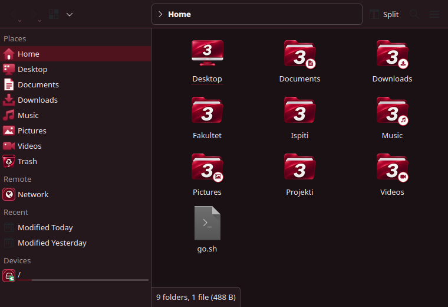
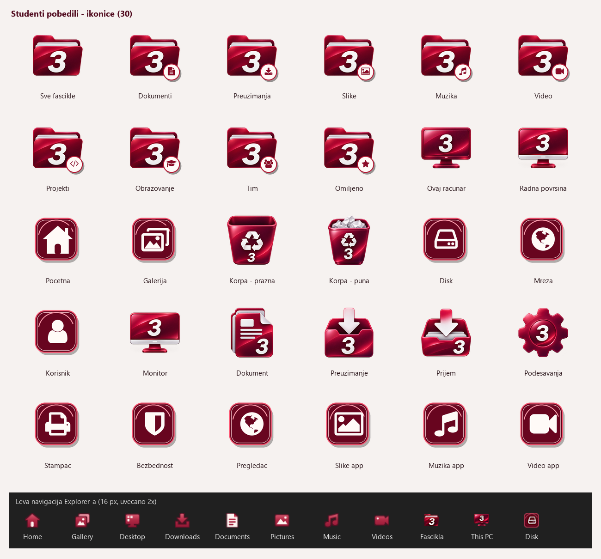
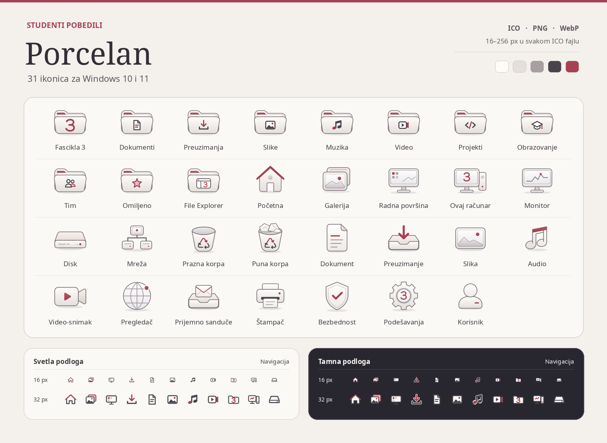
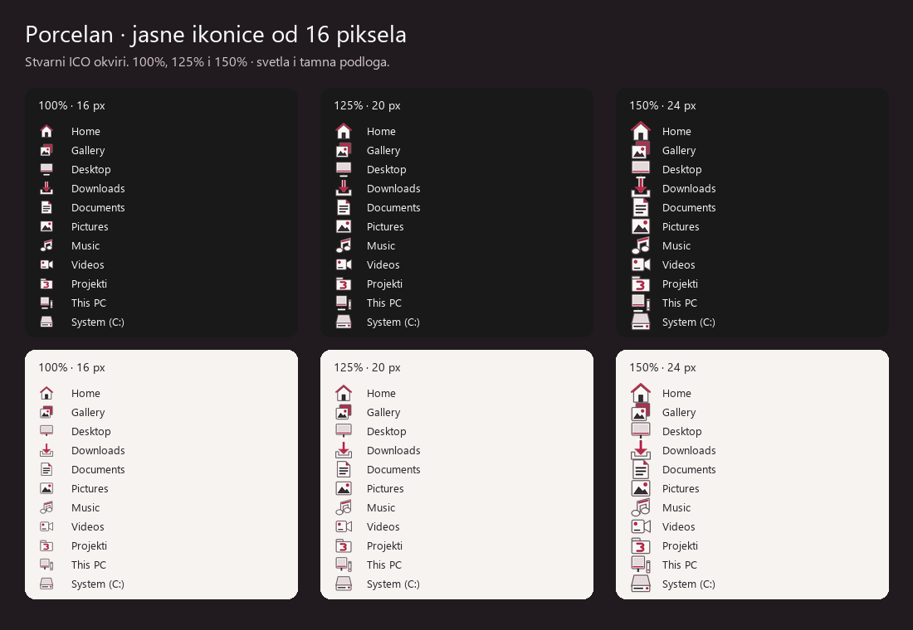
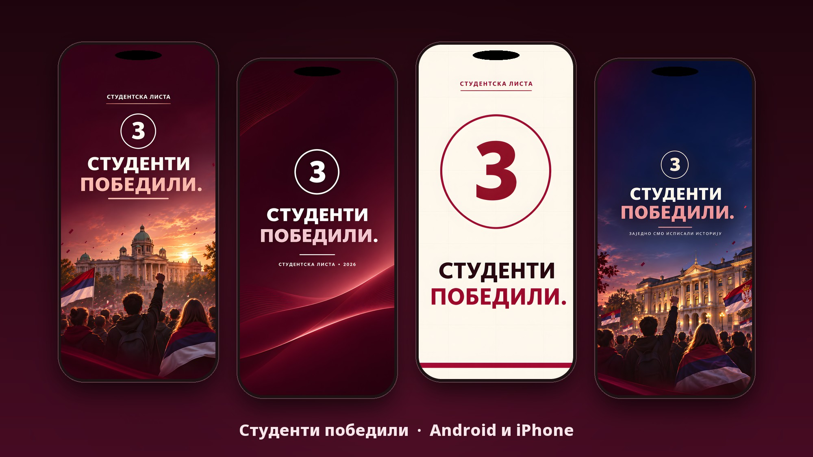

<div align="center">


# Studenti pobedili - tema za Windows, Linux, macOS i telefon

**Bordo tema sa pozadinama u 4K (srpske zastave), ikonicama u dva stila (Bordo i Porcelan), zaključanim ekranom i zvukom.**
Instalacija jednim klikom, bez admin prava, potpuna deinstalacija.

[**⬇ Windows (ZIP)**](https://github.com/zoxknez/studenti-pobedili-win11-10/releases/latest/download/StudentiPobedili-Windows-v2.zip)
&nbsp;·&nbsp; [**⬇ Linux (tar.gz)**](https://github.com/zoxknez/studenti-pobedili-win11-10/releases/latest/download/StudentiPobedili-Linux.tar.gz)
&nbsp;·&nbsp; [**⬇ macOS (ZIP, beta)**](https://github.com/zoxknez/studenti-pobedili-win11-10/releases/latest/download/StudentiPobedili-macOS.zip)
&nbsp;·&nbsp; [**⬇ Android i iPhone (ZIP)**](https://github.com/zoxknez/studenti-pobedili-win11-10/releases/latest/download/StudentiPobedili-Mobilni.zip)
&nbsp;·&nbsp; [**⬇ Nova serija (ZIP)**](https://github.com/zoxknez/studenti-pobedili-win11-10/releases/latest/download/StudentiPobedili-Nova-serija.zip)
&nbsp;·&nbsp; [Sva izdanja](https://github.com/zoxknez/studenti-pobedili-win11-10/releases)


</div>

## Instalacija na Windows-u

1. Preuzmite ZIP i raspakujte ga (desni klik › **Extract All**).
2. Pokrenite **`INSTALIRAJ.cmd`**. Ako Windows prikaže upozorenje: *More info › Run anyway*.
3. Izaberite **[1] KOMPLETNO - Bordo** (ili [2] za svetlu varijantu).

**Uvećate prikaz, a fascikle ponovo postanu žute?** U verziji **2.6.1** izaberite **[F]**, pa unesite lokaciju, npr. `D:\`. Opcija postavlja zasebnu ikonicu neposrednim potfasciklama i osvežava keš sličica, tako da ostaju u izabranom stilu i na Medium, Large i Extra large prikazu. Koristi poslednji stil (**P** = Porcelan, **5** = Bordo). Pregledi fotografija i video-fajlova ostaju uključeni; umesto pregleda sadržaja same fascikle vidi se njena ikonica.

Opcija **6** menja podrazumevanu ikonicu, ali Windows za popunjene fascikle može da napravi zasebnu žutu sličicu sadržaja. Zato je za njihov ujednačen izgled potreban **F**. Ne obilazi ceo disk: obrađuje samo jedan nivo odabrane lokacije, preskače sistemske i skrivene fascikle, veze i tuđe prilagođene ikonice. Za nove fascikle pokrenite **F** ponovo. Originalni `desktop.ini` i atributi se čuvaju; **9** i deinstalacija ih vraćaju.

Samo tema, bez skripti: preuzmite
[`Studenti-Pobedili-Bordo.deskthemepack`](https://github.com/zoxknez/studenti-pobedili-win11-10/releases/latest/download/Studenti-Pobedili-Bordo.deskthemepack)
ili
[`Studenti-Pobedili-Svetla.deskthemepack`](https://github.com/zoxknez/studenti-pobedili-win11-10/releases/latest/download/Studenti-Pobedili-Svetla.deskthemepack)
i otvorite ga dvoklikom (pre toga zatvorite Settings).

## Linux (GNOME i KDE Plasma)

```bash
tar xzf StudentiPobedili-Linux.tar.gz
cd StudentiPobedili-Linux
./install.sh            # meni; ili --bordo | --svetla | --ikonice | --porcelan | --deinstaliraj
```

Bez `sudo`, samo za vašeg korisnika (`~/.local/share`). Na **GNOME-u** pozadine prate tamni i svetli režim (Bordo i Svetle se same smenjuju), uz crveni akcenat (GNOME 47+), zaključani ekran i temu ikonica. Na **KDE Plasma-i** (5.24+ i 6) dobijate šemu boja „Studenti Pobedili Bordo“ ili „Svetla“ sa bordo naslovnim trakama, pozadinu sa tamnom i svetlom verzijom, zaključani ekran i ikonice za Dolphin. Ikonice koje tema nema uzimaju se iz teme koju ste do sada koristili. `--deinstaliraj` vraća tačno prethodna podešavanja.

<div align="center"></div>

Testirano u kontejnerima: Ubuntu 24.04 (GNOME 46), Fedora 41 (GNOME 47, KDE Plasma 6.4) i pravi Dolphin 25.04.

### Ubuntu Unity (iz zajednice)

Verziju za **Ubuntu Unity 7** napravio je **urosg3** ([GitHub](https://github.com/urosg3) · [X @UrosUbuntu](https://x.com/UrosUbuntu)): pozadine, zaključani ekran, tema ikonica i GTK teme Ambiance i Radiance (ako su instalirane).

[**⬇ StudentiPobedili-Unity.tar.gz**](https://github.com/zoxknez/studenti-pobedili-win11-10/releases/latest/download/StudentiPobedili-Unity.tar.gz) (ispravljena verzija; ista ispravka je poslata autoru kao [PR](https://github.com/urosg3/studenti_pobedili_Unity/pull/1)) · [izvorni kod](https://github.com/urosg3/studenti_pobedili_Unity)

```bash
tar xzf StudentiPobedili-Unity.tar.gz
cd StudentiPobedili-Unity && ./install.sh
```

## macOS (beta)

```bash
cd ~/Downloads/StudentiPobedili-macOS
./install.command       # meni; ili --bordo | --svetla | --porcelan | --fascikla PUTANJA | --deinstaliraj
```

Bez admin lozinke. Postavlja Bordo ili Svetlu pozadinu, tamni ili svetli režim, crveni akcenat (najbliži bordo u Apple paleti) i ikonice za Desktop, Documents, Downloads, Pictures, Music i Movies, a `--fascikla` daje crvenu „3“ bilo kojoj fascikli. macOS traži dozvolu da Terminal upravlja aplikacijom *System Events* i pristupa fasciklama. Ikonice u Dock-u, sidebar-u i korpi štiti sam sistem (SIP). Ako je fajl blokiran: `xattr -dr com.apple.quarantine StudentiPobedili-macOS`.

*Beta: logika je testirana sa simuliranim macOS komandama pod bash-om 3.2 i proverena shellcheck-om, ali još ne na dovoljno pravih Mac računara. Prijavite problem u Issues.*

## Šta dobijate (Windows)

| | |
|---|---|
| **Tema** | Bordo akcenat `#981F34` (kontrast 8,1:1), tamni ili svetli režim, bordo traka zadataka i naslovne trake |
| **Pozadine** | Slideshow od tri bordo pozadine 3840×2160 i svetla varijanta, plus ultrawide 5120×2160 i dve za tablet (2880×2160) |
| **Ikonice** | 31 ikonica u dva stila, Bordo i Porcelan (16-256 px, uključujući 20 i 40 px za 125% i 250%), leva navigacija Explorer-a sa posebnom siluetom za svaku stavku, File Explorer na traci zadataka |
| **Zaključani ekran** | Postavlja se automatski (16:9), plus dve uspravne verzije za telefon |
| **Zvuk** | Kratak zvuk „Pobeda“ za obaveštenja, uključuje se i isključuje jednom opcijom |
| **Vraćanje** | Opcija **D** vraća prethodnu temu, boje, ikonice i zvuk i briše fajlove paketa |

<div align="center"></div>

### Drugi stil ikonica: Porcelan

Istih 31 ikonica u svetloj seriji: mat bele površine, grafitni simboli i prigušena crvena. **U verziji 2.6 male ikonice od 16 do 48 px imaju krupnije simbole, jasnije konture i manje praznih margina.** Velike 3D ikonice zadržavaju svoj izgled. Čitljive su na svetloj i tamnoj podlozi.

| Sistem | Kako |
|---|---|
| Windows | `INSTALIRAJ.cmd` › **P** (nazad na bordo: **5**; opcija **6** prati izabrani stil) |
| Linux | `./install.sh --porcelan` ili `./install.sh --svetla --porcelan` |
| macOS | `./install.command --porcelan` ili `./install.command --svetla --porcelan` |

Pojedinačne ikonice su u [`Icons/Porcelan`](Icons/Porcelan) (ICO i PNG).

<div align="center"></div>

<div align="center"></div>

Za fizički veće ikonice u levoj navigaciji izaberite **Settings › System › Display › Scale › 125% ili 150%**. To povećava i tekst i ostale elemente. Paket ne menja skaliranje. Na [sajtu](https://studenti-tema.vercel.app/#ikonice) možete menjati stil, podlogu i skaliranje pregleda.

Obnova i provera ikonica (Python 3 + Pillow):

```powershell
python -I Install/Alati/Napravi-porcelan.py
python -I Install/Alati/Napravi-pregled-ikonica.py
python -I Install/Alati/Proveri-ikonice.py
```

## Nova serija

Deset novih ilustracija pobede (transparenti, strip, risograf, kolaž, dokumentarne scene), za računar, tablet i telefon, u punoj rezoluciji. Nisu deo slideshow-a teme, birate ih sami: [**`StudentiPobedili-Nova-serija.zip`**](https://github.com/zoxknez/studenti-pobedili-win11-10/releases/latest/download/StudentiPobedili-Nova-serija.zip) ili pojedinačno u fascikli [`Nova-serija`](Nova-serija) i na [sajtu](https://studenti-tema.vercel.app/#nova).

## Android i iPhone

[**`StudentiPobedili-Mobilni.zip`**](https://github.com/zoxknez/studenti-pobedili-win11-10/releases/latest/download/StudentiPobedili-Mobilni.zip) (3,8 MB) sadrži četiri pozadine za uspravni ekran (2160×3840), zvuk „Pobeda“ (`.ogg` za Android, `.m4a` i `.m4r` za iPhone) i uputstvo. Nema aplikacija ni dozvola. Pozadine se mogu sačuvati i direktno sa [sajta](https://studenti-tema.vercel.app/#telefon).

| | Android (12+) | iPhone (iOS 18+) |
|---|---|---|
| **Pozadina** | Galerija › ⋮ › Postavi kao pozadinu | Photos › Share › Use as Wallpaper |
| **Bordo boje** | Pozadina i stil › Boje pozadine (Material You iz pozadine) i „Tematske ikonice“ | Edit › Customize › Tinted, klizač na crvenu |
| **Zvuk** | `Pobeda.ogg` u fasciklu Notifications, pa izbor u podešavanjima zvuka | iOS 26: Files › `Pobeda.m4a` › Share › Use as Ringtone; starije verzije: `Pobeda.m4r` preko Finder-a ili Apple Devices |

Naslov i „3“ su u sredini, pa ostaju ceo i na dužim ekranima, gde telefon malo iseče levu i desnu ivicu.

<div align="center"></div>

## Bezbednost

- Standardne ikonice i tema koriste podešavanja **trenutnog korisnika** (HKCU), bez programa i interneta. Opcija **F** dodaje `desktop.ini` u odabrane obične fascikle uz rezervnu kopiju; zapis u samoj fascikli pokazuje na ikonicu instaliranu u vašem profilu.
- Pre svake izmene čuva original (`%LOCALAPPDATA%\StudentiPobedili`).
- Opcija **6** menja sistemsku podrazumevanu ikonicu (HKLM), pa traži UAC potvrdu. Sličice sadržaja popunjenih fascikli obrađuje zasebno opcija **F**.

## Struktura

```
INSTALIRAJ.cmd          glavni meni
Install/                PowerShell skripte (tema, ikonice, zaključani ekran, zvuk, deinstalacija)
Install/Alati/          alati: Napravi-themepack.ps1, Napravi-ikonice.py, Napravi-linux.py, Napravi-mac.py, Napravi-pozadine.py,
                        Napravi-nova-serija.py, Napravi-windows-paket.py, Uvecaj-pozadine.py (Python + Pillow)
Linux/                  install.sh, teme ikonica Bordo i Porcelan (freedesktop), KDE šeme boja
macOS/                  install.command (beta)
Mobilni/                pozadine i zvuk za Android i iPhone
Nova-serija/            10 dodatnih ilustracija u punoj rezoluciji
Teme/                   .deskthemepack paketi
Wallpapers/ LockScreen/ Icons/ (Icons/Porcelan/) Sounds/ Preview/
web/                    sajt (Vercel: vercel.json → outputDirectory "web")
```

---

<sub>Nezvanična fan-made personalizacija. Nije zvanični Windows paket niti zvanični proizvod Studentske liste. Windows je zaštitni znak kompanije Microsoft.</sub>
