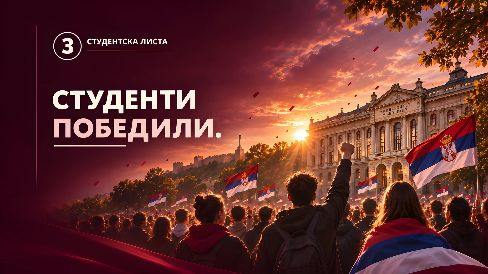

<div align="center">


# Studenti pobedili — tema za Windows, Linux i macOS

**Bordo tema sa 8 pozadina u 4K, 31 ikonicom, zaključanim ekranom i zvukom.**
Instalacija jednim klikom, bez admin prava, potpuna deinstalacija.

[**⬇ Windows (ZIP)**](https://github.com/zoxknez/studenti-pobedili-win11-10/releases/latest/download/StudentiPobedili-Windows-v2.zip)
&nbsp;·&nbsp; [**⬇ Linux (tar.gz)**](https://github.com/zoxknez/studenti-pobedili-win11-10/releases/latest/download/StudentiPobedili-Linux.tar.gz)
&nbsp;·&nbsp; [**⬇ macOS (ZIP, beta)**](https://github.com/zoxknez/studenti-pobedili-win11-10/releases/latest/download/StudentiPobedili-macOS.zip)
&nbsp;·&nbsp; [Sva izdanja](https://github.com/zoxknez/studenti-pobedili-win11-10/releases)



</div>

## Instalacija na Windows-u

1. Preuzmite ZIP i raspakujte ga (desni klik › **Extract All**).
2. Pokrenite **`INSTALIRAJ.cmd`**. Ako Windows prikaže upozorenje: *More info › Run anyway*.
3. Izaberite **[1] KOMPLETNO – Bordo** (ili [2] za svetlu varijantu).

Samo tema, bez skripti: preuzmite
[`Studenti-Pobedili-Bordo.deskthemepack`](https://github.com/zoxknez/studenti-pobedili-win11-10/releases/latest/download/Studenti-Pobedili-Bordo.deskthemepack)
ili
[`Studenti-Pobedili-Svetla.deskthemepack`](https://github.com/zoxknez/studenti-pobedili-win11-10/releases/latest/download/Studenti-Pobedili-Svetla.deskthemepack)
i otvorite ga dvoklikom (pre toga zatvorite Settings).

## Linux (GNOME i KDE Plasma)

```bash
tar xzf StudentiPobedili-Linux.tar.gz
cd StudentiPobedili-Linux
./install.sh            # meni; ili --bordo | --svetla | --ikonice | --deinstaliraj
```

Bez `sudo`, samo za vašeg korisnika (`~/.local/share`). Na **GNOME-u** pozadine prate tamni i svetli režim (Bordo i Svetle se same smenjuju), uz crveni akcenat (GNOME 47+), zaključani ekran i temu ikonica. Na **KDE Plasma-i** (5.24+ i 6) dobijate šemu boja „Studenti Pobedili Bordo“ ili „Svetla“ sa bordo naslovnim trakama, pozadinu sa tamnom i svetlom verzijom, zaključani ekran i ikonice za Dolphin. Ikonice koje tema nema uzimaju se iz teme koju ste do sada koristili. `--deinstaliraj` vraća tačno prethodna podešavanja.

<div align="center"></div>

Testirano u kontejnerima: Ubuntu 24.04 (GNOME 46), Fedora 41 (GNOME 47, KDE Plasma 6.4) i pravi Dolphin 25.04.

## macOS (beta)

```bash
cd ~/Downloads/StudentiPobedili-macOS
./install.command       # meni; ili --bordo | --svetla | --fascikla PUTANJA | --deinstaliraj
```

Bez admin lozinke. Postavlja Bordo ili Svetlu pozadinu, tamni ili svetli režim, crveni akcenat (najbliži bordo u Apple paleti) i ikonice za Desktop, Documents, Downloads, Pictures, Music i Movies, a `--fascikla` daje crvenu „3“ bilo kojoj fascikli. macOS traži dozvolu da Terminal upravlja aplikacijom *System Events* i pristupa fasciklama. Ikonice u Dock-u, sidebar-u i korpi štiti sam sistem (SIP). Ako je fajl blokiran: `xattr -dr com.apple.quarantine StudentiPobedili-macOS`.

*Beta: logika je testirana sa simuliranim macOS komandama pod bash-om 3.2 i proverena shellcheck-om, ali još ne na dovoljno pravih Mac računara. Prijavite problem u Issues.*

## Šta dobijate (Windows)

| | |
|---|---|
| **Tema** | Bordo akcenat `#981F34` (kontrast 8,1:1), tamni ili svetli režim, bordo traka zadataka i naslovne trake |
| **Pozadine** | 8 pozadina 3840×2160 i slideshow koji ne stavlja tekst ispod desktop ikonica |
| **Ikonice** | 31 ikonica (16–256 px, uključujući 20 i 40 px za 125% i 250%), leva navigacija Explorer-a sa posebnom siluetom za svaku stavku, File Explorer na traci zadataka |
| **Zaključani ekran** | Postavlja se automatski (16:9), plus dve uspravne verzije za telefon |
| **Zvuk** | Kratak zvuk „Pobeda“ za obaveštenja, uključuje se i isključuje jednom opcijom |
| **Vraćanje** | Opcija **D** vraća prethodnu temu, boje, ikonice i zvuk i briše fajlove paketa |

<div align="center"></div>

## Uskoro

| Sistem | Status | Šta će sadržati |
|---|---|---|
| **Android** | U pripremi | Pozadine i zaključani ekran (Material You preuzima bordo iz pozadine) |
| **iPhone** | U pripremi | Pozadine i zaključani ekran za uspravni ekran |

Nove verzije se pojavljuju na stranici [izdanja](https://github.com/zoxknez/studenti-pobedili-win11-10/releases).

## Bezbednost

- Menja samo podešavanja **trenutnog korisnika** (HKCU), bez programa i interneta.
- Pre svake izmene čuva original (`%LOCALAPPDATA%\StudentiPobedili`).
- Izuzetak je opciona crvena „3“ za *sve* obične fascikle: Windows tu ikonicu čita samo iz HKLM, pa traži UAC potvrdu.

## Struktura

```
INSTALIRAJ.cmd          glavni meni
Install/                PowerShell skripte (tema, ikonice, zaključani ekran, zvuk, deinstalacija)
Install/Alati/          alati: Napravi-themepack.ps1, Napravi-ikonice.py, Napravi-linux.py, Napravi-mac.py (Python + Pillow)
Linux/                  install.sh, tema ikonica (freedesktop), KDE šeme boja
macOS/                  install.command (beta)
Teme/                   .deskthemepack paketi
Wallpapers/ LockScreen/ Icons/ Sounds/ Preview/
web/                    sajt (Vercel: vercel.json → outputDirectory "web")
```

---

<sub>Nezvanična fan-made personalizacija. Nije zvanični Windows paket niti zvanični proizvod Studentske liste. Windows je zaštitni znak kompanije Microsoft.</sub>
